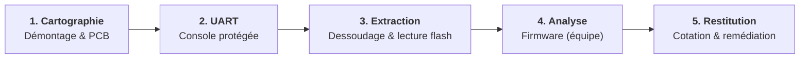

> **Confidentialité :** la marque et le modèle de la caméra, ainsi que les adresses IP/MAC réelles, ont été volontairement anonymisés. Aucun extrait de clé privée ni de certificat n'est publié.

## Contexte & périmètre

Projet noté du cours de mise en pratique de l'audit à l'EPITA (après la partie théorique), sur sujet libre. Nous étions une **équipe de trois**, sur environ un mois et demi, avec un rendu en **mai 2026**.

La cible : une **caméra IP motorisée (PTZ) d'intérieur**, achetée dans le commerce pour l'exercice. J'ai proposé ce sujet par goût pour le matériel, parce que l'impact d'une caméra est concret (le flux vidéo d'un logement), et en choisissant un modèle d'entrée de gamme avec l'hypothèse qu'il serait moins durci.

L'audit a été mené en **boîte noire**, sans aucune documentation. L'objectif : déterminer ce qu'un attaquant peut obtenir à partir d'un **accès physique** à l'appareil. La démarche s'appuie sur les référentiels **OWASP IoT Top 10**, **ANSSI** et **ETSI EN 303 645**.

**Répartition :** j'ai pris en charge toute la **partie matérielle** (démontage, cartographie du PCB, recherche et exploitation de l'UART, dessoudage et lecture de la mémoire flash). Mes deux coéquipiers se sont concentrés sur le **reverse du firmware**.

---

## Démarche matérielle (ma partie)

1. **Démontage & cartographie du PCB** : identification des composants principaux :
   - **SoC Ingenic T23** (architecture MIPS/XBurst) ;
   - **Flash SPI NOR de 8 Mo** (boîtier SOP8), qui contient l'image firmware ;
   - **EEPROM I²C de 16 Ko** (boîtier SOIC8), **chiffrée au repos**, un point positif ;
   - **module Wi-Fi** avec antennes U.FL.
2. **Recherche de l'UART de debug** : repérage de 4 pastilles sur la carte et identification des broches au multimètre. Le port est actif à **115 200 bauds**.
3. **Constat sur la console** : elle lance un `getty` avec **login par mot de passe**. Il n'y a **pas d'accès root direct** par ce biais, et c'est précisément ce qui nous a poussés à passer par l'extraction physique de la mémoire.
4. **Dessoudage de la flash** à l'air chaud, puis **lecture du contenu sur programmateur** pour obtenir un dump complet de l'image.

---

## Analyse du firmware (équipe)

À partir du dump, nous avons extrait l'arborescence avec **Binwalk**, puis analysé les fichiers de configuration et les binaires. L'image se compose de :

- un noyau **Linux 3.10.14** (uImage compressée LZMA), branche en fin de vie ;
- le bootloader **U-Boot 2013.07** ;
- un userland **BusyBox + uClibc 0.9.33** ;
- les partitions `rootfs` (SquashFS), `/app` (SquashFS) et `/conf` (JFFS2).

---

## Constats

Au terme de l'audit, le rapport recense **13 constats de sécurité**, pour un niveau de risque global **ÉLEVÉ**. Les principaux sont présentés ci-dessous. Ceux qui proviennent du firmware ont tous été **revérifiés à la main sur le dump de la flash** ; HW-02 provient d'une **observation sur la carte**. Chaque risque est coté selon la grille **impact × vraisemblance** (note sur 25).

| Réf. | Domaine | Cotation (impact × vraisemblance) | Constat | Preuve |
|---|---|---|---|---|
| **AUTH-01** | Authentification | **Critique (20/25)** | Mot de passe root haché en **MD5crypt**, un algorithme faible | `/etc/shadow` : `root:$1$…` |
| **OS-01** | Système | **Critique (16/25)** | Noyau **Linux 3.10.14**, branche en fin de vie : d'après sa version, il est potentiellement exposé à des CVE publiques comme **Dirty COW** (CVE-2016-5195), non testé. De plus, **tous les binaires sont compilés sans PIE** : leur code est chargé à une adresse fixe, ce qui réduit fortement l'efficacité de l'ASLR | en-tête uImage / `Linux version` ; `readelf -h` sur les binaires : `Type: EXEC` |
| **CRY-01** | Cryptographie | **Élevé (12/25)** | **Clé privée RSA et certificats TLS stockés en clair** | `/conf` (JFFS2) : `client_key.pem`, `ca_cert.pem` |
| **HW-02** | Mémoires | **Élevé (12/25)** | Flash SPI NOR **lisible et réinscriptible**, sans protection d'écriture ni **Secure Boot** | observation sur la carte |
| **HW-01** | Interfaces | **Élevé (9/25)** | UART de debug actif, protégé par un login par mot de passe | `/etc/inittab` : `getty … console 115200` |
| **NET-01** | Services | **Élevé (9/25)** | Démon **Telnet** présent : désactivé, mais réactivable | `/usr/sbin/telnetd` + ligne `#telnetd &` commentée |
| **CLD-01** | Cloud | **Élevé (8/25)** | **Adresse cloud codée en dur, appelée en HTTP** (sans chiffrement) | chaîne `http://<ip>/v2` dans `/app/bin/ipc` |

**Précisions sur AUTH-01 :**
- Le hachage est **cassable** hors ligne (estimation : environ 5 h de calcul). Nous ne l'avons **pas cassé**, faute de temps.
- Il est **très probablement partagé** par tous les appareils de cette gamme, puisqu'il fait partie de l'image firmware commune. C'est une déduction : une seule caméra a été testée.

### Autre observation sur la carte

- Aucun **enrobage** des puces : les composants sont directement accessibles pour le probing et le dessoudage.

### Point positif

- L'**EEPROM I²C est chiffrée au repos** : son contenu n'est pas exploitable par une simple lecture.

---

## Plan de remédiation priorisé

### Actions immédiates

| Constat | Recommandation |
|---|---|
| **AUTH-01** | Un mot de passe **unique par appareil**, haché avec un algorithme lent (**yescrypt** ou **SHA-512-crypt**) |
| **CRY-01** | **Chiffrer la partition `/conf`** qui contient les clés et certificats |
| **HW-01** | **Désactiver la console série** en production |
| **NET-01** | **Retirer `telnetd`** de l'image de production |
| **CLD-01** | Passer en **HTTPS avec validation du certificat** |
| **HW-02** | Activer la **protection d'écriture** de la flash (broche `WP` et verrouillage des blocs) |

### À plus long terme

| Constat | Recommandation |
|---|---|
| **HW-02** | Mettre en place un **Secure Boot** |
| **CRY-01** | Stocker les clés dans un **élément sécurisé** dédié |
| Observation carte | **Enrobage époxy** et abrasion des marquages des composants sensibles |

---

## Ce que j'en retire

- La valeur d'un audit tient d'abord à la **méthode** et à la **restitution**, pas seulement à la liste des failles trouvées.
- Il faut toujours **distinguer un constat démontré** (vérifié sur le dump) **d'une piste à confirmer** (déduction, hypothèse non testée).
